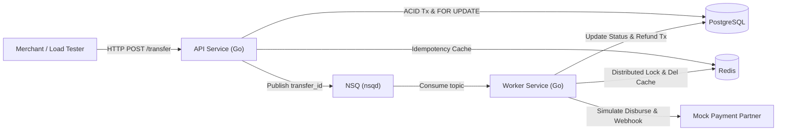
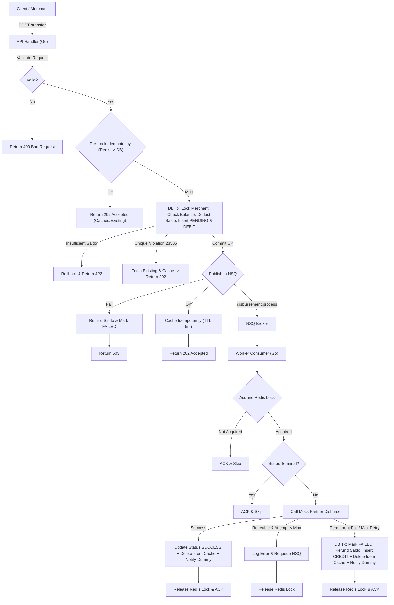

# Technical Design — Money Transfer (Disbursement) Service

## 1. Overview & Goals
Service ini adalah backend disbursement/money transfer yang menerima permintaan transfer dari merchant melalui HTTP API, memotong saldo merchant secara **concurrency-safe (ACID)** di awal, lalu memproses pengiriman dana ke payment provider secara **asynchronous** menggunakan message broker.

### Core Guarantees
- **No Race Condition / No Negative Balance**: Pemotongan saldo dilakukan secara atomik di dalam database transaction (`SELECT ... FOR UPDATE` + `CHECK (balance >= 0)`).
- **Safe Rollback**: Jika proses transfer gagal secara permanen (atau gagal publish ke broker), saldo merchant dikembalikan (*refund*) secara idempotent (maksimal 1x).
- **At-Least-Once Processing Safe**: Consumer aman terhadap duplikasi pesan maupun retry dari message broker.

---

## 2. Tech Stack
| Komponen | Pilihan | Alasan |
| :--- | :--- | :--- |
| **Language** | Golang | Performa tinggi, concurrency-friendly, idiomatic untuk microservice & NSQ. |
| **Database** | PostgreSQL | Mendukung ACID transaction dan row-level locking (`SELECT ... FOR UPDATE`) untuk menjamin konsistensi saldo. |
| **Message Broker** | NSQ (`nsqd`) | Ringan, native Go (`go-nsq`), mendukung requeue dengan backoff dan `MaxAttempts` untuk retry. |
| **Cache & Distributed Lock** | Redis | 1) Fast-path idempotency cache di API (TTL 5 menit, graceful fallback ke Postgres).<br>2) Distributed processing lock di Worker (`SET NX EX 30s` + Lua unlock) untuk mencegah duplicate concurrent disbursement. |

---

## 3. Architecture & Flows

### A. System Architecture


### B. Flow Diagram


### C. Main Flow (Happy Path)
```
Merchant/Client
   │
   │ POST /transfer (Idempotency-Key, bank_code, account_number, amount)
   ▼
[API Service (Go)]
   ├─ 1. Handler validasi payload (`bank_code`, `account_number`, `amount > 0`, generate UUID jika `idempotency_key` kosong)
   ├─ 2. Pre-lock Idempotency Check (`checkIdempotencyPreLock`):
   │     ├─ Cek Redis cache (`idem:transfer:<merchant_id>:<key>`); fallback ke Postgres jika Redis error/miss
   │     └─ Lock-free DB read (`GetByIdempotencyKey`); jika ada, re-cache ke Redis & return `202 Accepted`
   ├─ 3. BEGIN DB Transaction (`WithTx`)
   │     ├─ Lock row merchant (`SELECT ... FROM merchants WHERE id = $1 FOR UPDATE`)
   │     ├─ Validasi `balance >= amount` (jika kurang -> ROLLBACK & return `422`)
   │     ├─ Deduct balance (`UPDATE merchants SET balance = balance_after ...`)
   │     ├─ Insert `transfers` (status = `PENDING`; tangkap unique violation `23505` sebagai `ErrDuplicateTransfer`)
   │     └─ Insert ledger mutation (`DEBIT`)
   ├─ 4. COMMIT DB Transaction
   ├─ 5. Publish message (`transfer_id`) ke NSQ topic `disbursement.process`
   ├─ 6. Best-effort cache response ke Redis (TTL 5 menit)
   └─ 7. Return `202 Accepted` (transfer_id, status: `PENDING`, amount)
          │
          ▼
   [NSQ Broker]
          │
          ▼
[Background Worker / Consumer (Go)]
   ├─ 1. Acquire Redis distributed lock `lock:transfer:<id>` (`SET NX EX 30s`)
   │     └─ Jika gagal acquire (sedang diproses worker lain), ACK & skip
   ├─ 2. Ambil `transfers` dari DB (`GetByID`); cek apakah status sudah terminal
   │     └─ Jika `SUCCESS` / `FAILED`, ACK message & skip (idempotent)
   ├─ 3. Simulasi call ke Mock Payment Provider (`Disburse`: random delay 100-800ms + random outcome)
   ├─ 4. Jika Provider SUCCESS:
   │     ├─ Update `transfers` status -> `SUCCESS` (atomic check `status NOT IN ('SUCCESS', 'FAILED')`)
   │     ├─ Delete idempotency cache di Redis (best-effort) agar retry berikutnya mendapat status `SUCCESS`
   │     └─ Trigger dummy notification & dummy merchant webhook (`NotifyDummy`)
   └─ 5. `defer` Release Redis lock dengan Lua script (cek ownership token)
```

### D. Negative & Failure Flows
1. **Validasi Input Gagal / Saldo Tidak Cukup**
   - Validasi input gagal ditolak di handler (`400 Bad Request`).
   - Saldo tidak cukup ditolak sebelum insert (`422 Unprocessable Entity`). Saldo tidak berubah.
2. **Duplicate Race di Milidetik yang Sama (`23505`)**
   - Jika 2 request dengan `idempotency_key` sama lolos pre-lock bersamaan, `INSERT` kedua terkena `UNIQUE INDEX` (`ErrDuplicateTransfer`). Transaksi otomatis rollback dan `handleDuplicateRace` mengembalikan transaksi eksisting (`202 Accepted`) + update cache Redis.
3. **Gagal Publish ke NSQ (setelah DB Commit)**
   - **Mitigasi**: API langsung memanggil `refundTransfer` (update status -> `FAILED` dengan reason `broker_publish_failed`, refund saldo merchant, catat ledger `CREDIT`), lalu return `503 Service Unavailable`. Response gagal ini tidak di-cache ke Redis.
4. **Consumer Menerima Pesan dengan Status Terminal (`SUCCESS` / `FAILED`)**
   - Log info dan **ACK (`return nil`)** agar pesan tidak berputar di NSQ.
5. **Error dari Payment Provider — Retryable (`ErrRetryable`)**
   - Jika `attempt < max_attempts`: log error, release Redis lock, dan **requeue** message ke NSQ (tanpa hit DB berulang).
6. **Error dari Payment Provider — Non-Retryable (`ErrNonRetryable`) atau Retry Habis (`attempt >= max_attempts`)**
   - Jalankan `refundTransfer` di dalam `WithTx`:
     - Lock row `transfers` (`GetByIDForUpdate`), pastikan status belum terminal (mencegah *double refund*).
     - Update `transfers` status -> `FAILED`, simpan `failure_reason`.
     - Lock row `merchants` (`GetByIDForUpdate`), kembalikan saldo (`balance + amount`).
     - Insert ledger mutation (`CREDIT`).
   - Delete idempotency cache di Redis (best-effort) agar retry berikutnya mendapat status `FAILED`.
   - Trigger `NotifyDummy` dengan status `FAILED`, release Redis lock, dan ACK message ke NSQ.

---

## 4. Transaction State Machine

| Status | Deskripsi | Terminal? | Transisi Berikutnya |
| :--- | :--- | :---: | :--- |
| `PENDING` | Request valid, saldo sudah dipotong, menunggu/sedang diproses worker. | Tidak | `SUCCESS`, `FAILED` |
| `SUCCESS` | Transfer berhasil diproses oleh provider. | **Ya** | - |
| `FAILED` | Transfer gagal permanen / retry habis; saldo merchant sudah dikembalikan. | **Ya** | - |

> **Catatan**: Validasi request yang gagal di API layer (payload tidak valid / saldo tidak cukup) langsung dikembalikan sebagai HTTP error response tanpa masuk ke tabel transaksi.

---

## 5. Database Schema (PostgreSQL)

> **Catatan Tipe Data**: Nominal uang menggunakan `BIGINT` (satuan terkecil, misal Rupiah penuh atau sen) — **tidak menggunakan `FLOAT`/`DOUBLE`** untuk menghindari masalah presisi.

### Table: `merchants`
| Column | Type | Constraint | Keterangan |
| :--- | :--- | :--- | :--- |
| `id` | `BIGINT` | `PRIMARY KEY` | Hardcoded `1` untuk MVP (seed saldo 100.000.000) |
| `name` | `VARCHAR(100)` | `NOT NULL` | Nama merchant |
| `balance` | `BIGINT` | `NOT NULL, CHECK (balance >= 0)` | Guard di level DB agar saldo tidak pernah negatif |
| `created_at` | `TIMESTAMPTZ` | `NOT NULL DEFAULT NOW()` | |
| `updated_at` | `TIMESTAMPTZ` | `NOT NULL DEFAULT NOW()` | |

### Table: `transfers`
| Column | Type | Constraint | Keterangan |
| :--- | :--- | :--- | :--- |
| `id` | `UUID` | `PRIMARY KEY` | ID transaksi internal |
| `merchant_id` | `BIGINT` | `NOT NULL REFERENCES merchants(id)` | |
| `idempotency_key` | `VARCHAR(100)` | `NOT NULL` | Mencegah double deduction pada request duplikat |
| `partner_id` | `VARCHAR(50)` | `NOT NULL` | ID mock payment provider |
| `bank_code` | `VARCHAR(20)` | `NOT NULL` | Kode bank tujuan |
| `account_number` | `VARCHAR(50)` | `NOT NULL` | Nomor rekening tujuan |
| `amount` | `BIGINT` | `NOT NULL, CHECK (amount > 0)` | Nominal transfer |
| `status` | `VARCHAR(20)` | `NOT NULL` | `PENDING`, `SUCCESS`, `FAILED` |
| `retry_count` | `INT` | `NOT NULL DEFAULT 0` | Jumlah percobaan retry |
| `failure_reason` | `TEXT` | `NULL` | Alasan gagal (jika `FAILED`) |
| `created_at` | `TIMESTAMPTZ` | `NOT NULL DEFAULT NOW()` | |
| `updated_at` | `TIMESTAMPTZ` | `NOT NULL DEFAULT NOW()` | |

*Index*: `UNIQUE INDEX idx_transfers_merchant_idempotency ON transfers (merchant_id, idempotency_key)`

### Table: `balance_mutations` (Audit Trail / Ledger)
| Column | Type | Constraint | Keterangan |
| :--- | :--- | :--- | :--- |
| `id` | `BIGINT` | `PRIMARY KEY GENERATED ALWAYS AS IDENTITY` | |
| `merchant_id` | `BIGINT` | `NOT NULL REFERENCES merchants(id)` | |
| `transfer_id` | `UUID` | `NOT NULL REFERENCES transfers(id)` | |
| `type` | `VARCHAR(20)` | `NOT NULL` | `DEBIT` (potong saldo) atau `CREDIT` (refund) |
| `amount` | `BIGINT` | `NOT NULL` | |
| `balance_before` | `BIGINT` | `NOT NULL` | |
| `balance_after` | `BIGINT` | `NOT NULL` | |
| `created_at` | `TIMESTAMPTZ` | `NOT NULL DEFAULT NOW()` | |

---

## 6. Cutting Corners & Future Improvements (Production)
- **Single Partner Repo**: Dummy partner disburse & webhook/notification disatukan dalam satu repo `partner`, seharusnya dipisah sesuai service masing-masing.
- **No Auth / HTTP Hardening**: Belum mengimplementasikan autentikasi merchant (JWT/API key), message signing ke partner, maupun `http.MaxBytesReader` / rate limiting.
- **Worker Timeout & DLQ**: Worker belum membungkus setiap message dengan `context.WithTimeout` khusus per-job dan belum ada Dead Letter Queue (DLQ) jika message gagal diproses hingga `max_attempts` akibat error infrastruktur.
- **Test Coverage**: Belum ada unit test coverage penuh (interface-first sudah disiapkan agar mudah di-mock).
- **Stranded Balance Mitigation**: Jika publish ke NSQ gagal dan kompensasi refund juga gagal, saat ini hanya dicatat sebagai log `CRITICAL`; di production seharusnya menggunakan **Transactional Outbox Pattern** dan **Reconciliation / Sweeper Job**.
- **Observability & Audit**: Di production perlu menambahkan metrics (Prometheus/OTel), structured logging, serta tabel/analytics log per attempt (`transfer_attempts`) jika dibutuhkan untuk investigasi dispute.
- **Extreme Throughput Scaling**: Saat ini `SELECT ... FOR UPDATE` pada `merchants` sangat aman untuk ratusan TPS; jika satu merchant menembak ribuan TPS terus-menerus (*hot row contention*), dapat ditingkatkan menggunakan **Balance Sharding** atau **Partitioned Single-Writer Queue**.
